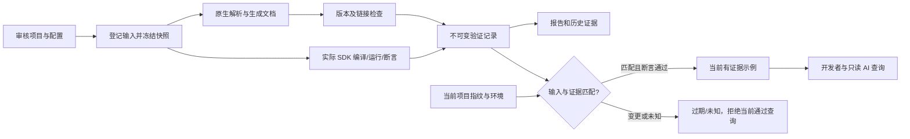

# CJ-DocGuard 参赛产品需求文档

**定位：仓颉可执行文档与版本验证工具。**为每个使用示例提供可复验的执行证据，代码、依赖或工具链变化后让旧结果失效，并将符合环境条件的示例提供给开发者与 AI 助手。

| 文档项 | 内容 |
|---|---|
| 版本与日期 | PRD v1.0，2026-10-06，北京时间 |
| 推荐参赛题目 | 推荐技术课题 #9「项目级API文档生成及测试」 |
| 受众 | 老陈、参与开发的 AI 助手、后续维护者及参赛评审 |
| 当前阶段 | 需求与选题已形成；**产品尚未实现，本文指标全部为待实测目标** |
| 人力基线 | 一名参赛者＋AI 辅助开发；无现成仓颉作品；每日可投入时长未提供 |
| 已核验本地环境 | macOS arm64，zsh；检查时 cjc/cjpm 不在 PATH，SDK 是否位于其他目录未确认 |
| 产品名称 | CJ-DocGuard 为暂定名，仓库名/包名需在发布前查重 |
| 核心约束 | 初赛 2026-10-07 23:59:59 截止；不夸大范围、不模拟通过结果、不承诺奖项 |

PRD 是产品需求文档，说明产品为谁解决什么问题、功能边界、验收标准及交付顺序。本文可直接用于拆分实施任务；**写入本文不代表功能已完成或官方验收已通过**。

## 1. 选题结论与比赛策略

**主选 #9，围绕“带版本边界、会失效、可复验的示例证据”构建作品。**它能持续用于库维护、发布前检查、作品集展示及开源贡献，也有可现场展示的技术闭环。

| 候选 | 价值与优势 | 当前代价 | 结论 |
|---|---|---|---|
| #9 文档与验证工具 | 将库文档、示例回归、版本检查和 AI 可靠上下文连在一起；普通后端工程能力较易迁移 | 同题已有工具，必须做出可测差异；初赛工期仍很紧 | **采用** |
| #2 CJ-Reduce | 编译器故障缩减与独立复现，技术深度高 | 真正的差异集中在跨包、依赖保持与故障判据，零基础一天难闭环 | 当前不主攻 |
| holiday4cj | 可用于排班与工作日计算，范围相对易理解 | 推荐题资格未确认；数据更新责任长期存在；离线能力并非空白创新 | 保留已有草案，当前不主攻 |

以上为工程判断，置信度中，不能推导获奖率。原有 `参赛方案.md` 保留不改，详细证据与取舍见 [选题决策](/Users/a111/chen/竞赛/仓颉生态创新开发挑战赛/赛事分析/一等奖选题决策-2026-10-06.md)。

### 1.1 冲击一等奖的证据目标

一等奖只有一个，评委评分与其他作品质量未知。可控目标是形成以下四类证据：

1. **完成题目：**结构化可检索 API 文档、真实示例测试、SDK 对应及索引链接检查，逐项展示。
2. **体现差异：**输入变化后自动拒绝旧证据，真实版本执行记录，AI 查询失败时的清晰边界。
3. **证明实用：**除自建测试项目外，在授权真实仓颉项目中复用，并提交复验材料。
4. **能够答辩：**老陈能解释状态设计、错误处理、解析限制、测试分母和 AI 使用方式。

初赛基础评分重视代码质量30、创新20、实用20、文档15、完成度10、社区5；基础至少60且代码质量至少18，演示视频与统一模板必须有效。决赛占最终成绩70%，AI 生态贡献是否加分、加多少均需评委核验。不能用“AI 写了代码”代替生态贡献。[官方评分与提交要求](https://competitions.atomgit.com/competition/2090379383571447809/intro)

### 1.2 已有工具与差异边界

[cjdoc-lab](https://gitcode.com/hongwei-2026/cjdoc-lab) 的 README 已描述生成、搜索、示例编译、版本/链接检查、签名漂移、报告和 Skill。因此，普通“文档＋测试＋报告＋AI”不构成充分差异。该项目的实现及效果尚未独立复跑；公开说明未展示某项能力不代表源码没有它。

旧版官方 [cjdoc](https://docs.cangjie-lang.cn/docs/0.53.13/tools/source_zh_cn/tools/cjdoc_manual.html) 已提供文档生成；[CangjieMagic](https://gitcode.com/Cangjie-TPC/CangjieMagic/tree/dev) 已有文档与 MCP 相关能力。本文不宣称首创可执行文档、首个仓颉文档工具或首个仓颉 AI 接口。

实施前完成主要竞品代码与行为复核，保留对比版本和日期。产品差异表必须填写“本项目实际结果”“竞品已核验结果”“未核验部分”，不能只对比宣传名称。

## 2. 背景、用户与问题

### 2.1 要解决的问题

仓颉库使用者需要知道：例子在哪个 SDK 和平台上验证过；改动接口或依赖后是否仍适用；编译通过是否包含行为检查；AI 给出的示例有没有实际执行依据。现有页面或历史测试输出通常需要维护者额外解释这些上下文。

**本产品解决证据的可追踪性与有效边界。**它不会证明整个 API 没有缺陷，也不保证使用示例覆盖全部真实业务。

### 2.2 目标用户与待完成工作

| 用户 | 触发场景 | 希望完成的工作 | 产品输出 |
|---|---|---|---|
| 仓颉三方库维护者，首要用户 | 准备发布、修改签名或更新依赖 | 确认文档与示例对应当前项目，发现缺文档、坏链接及失效示例 | 文档站点、诊断与执行证据 |
| 学习/使用库的开发者 | 查找调用方式 | 找到目标 SDK 下验证过的例子，并按记录复验 | API 页面、环境说明、复验入口 |
| 使用 AI 编码的开发者 | 让助手调用一个陌生 API | 给助手提供当前版本可用示例，排除历史或未验证样例 | 只读证据检索，P1 |
| 评委/后续维护者 | 审查工程与演示 | 重现成功、失败和输入失效流程，理解支持边界 | 固定样本、原始日志、初赛/决赛差异 |

目前没有外部用户访谈或采用数据。以上需求是假设；通过真实库复用和维护者反馈继续验证。联络外部维护者另行取得用户授权，本文不触发自动外发消息。

### 2.3 比赛之外的持续价值

- **工作：**将文档示例纳入发布检查，减少接口变化后示例无人重验的问题；推广到其他语言需另做适配，当前不承诺。
- **作品集：**展示仓颉原生工具、AST 提取、进程控制、证据状态、自动验收和实际 SDK 对照，而非只有截图。
- **开源贡献：**提供可复用 CLI、报告格式、示例清单与 AI 检索接口；向真实项目提出可审查的文档/测试贡献。

比赛后以“真实项目愿意持续使用”为后续衡量标准，不以 Star 数代替可靠性或采用效果。

## 3. 产品目标与明确不做的范围

### 3.1 阶段定义

| 阶段 | 产品目标 | 完成口径 |
|---|---|---|
| P0：初赛候选版本 | 在审核过的本地仓颉项目上完整走通三项题目交付，并实现保守证据失效 | 第5节 P0 功能通过对应验收；材料完整；限制明确 |
| P1：决赛候选版本 | 实测两个 SDK，扩展真实项目，提供只读证据查询与 AI 复用证明 | 必需P1验收与实际数据齐全；AI对比实验为可选研究；保留相对初赛的迭代记录 |
| P2：赛后 | 降低接入成本、按用户需求扩展覆盖及平台 | 基于用户证据另行定义，不计入当前交付承诺 |

P0/P1 是本项目优先级，不是主办方认可的阶段豁免。#9 完整交付和语言限制必须在开工前核对最新任务书；当前已取得的官方聚合任务清单不能替代未读到的全部附件。

### 3.2 非目标

不在当前版本建设在线 SaaS、账号计费、社区平台、向量数据库、全功能 IDE 插件、SDK 安装管理器或自动代码修复器。不修改仓颉编译器，不承诺全量语义分析、所有宏展开或所有平台。AI 检索服务不提供任意命令执行。

不同时开发 holiday4cj 等第二个完整产品。HTML 报告使用简洁可读的静态页面，优先保证流程和证据，避免把主要工期投入装饰性界面。

## 4. 支持范围与信任边界

### 4.1 首版输入

P0 支持一个审核过的本地项目目录，递归处理纳入清单的 `.cj` 源码；构建配置、文档、示例、测试、数据与实际参与构建的本地依赖全部登记。默认排除输出目录、版本控制目录和工具自己的证据目录，并显示排除规则。

初赛样本以无网络依赖、无未登记原生库的纯本地工程为主。远程依赖须先解析并固定实际内容，不能只记录版本号。输入路径逃逸、符号链接跨出审核根、未登记的生成物或外部输入，必须报告，禁止静默扩大执行范围。

### 4.2 API 提取边界

使用仓颉 `std.ast` 提取源文件语法结构。1.1.3 官方 `parseProgram` 明确处理单个源文件；不应把它解释为完整类型或跨包分析。[1.1.3 API](https://cj-docs.gitcode.com/zh/1.1.3/libs/std/ast/ast_package_api/ast_package_funcs.html)，[官方源文档互证](https://github.com/cangjielanguage/cangjie_runtime/blob/release/1.1/stdlib/doc/libs/std/ast/ast_package_api/ast_package_funcs.md)

| 能力 | P0 目标 | 边界 |
|---|---|---|
| 顶层声明与签名 | 提取明确写出的公共函数、类型、常量/变量 | 默认可见性按指定版本规则核验；无法确定时显示候选声明 |
| 类型成员 | 提取显式声明的公共成员与所属类型 | 不从继承关系推断完整可调用接口 |
| 参数、返回值、泛型 | 保存源码明确标注的内容和源码位置 | 推断返回类型写为“未推断”，不得编造 |
| 注释与示例 | 保留原始文本并关联符号/示例清单 | 不把自然语言自动补全内容写成作者承诺 |
| 宏、条件编译、扩展、重载等 | 检出并记录处理情况 | 实际未支持项列为未验证；保留源码入口，不悄悄省略 |

生成器必须显示扫描文件数、成功/失败/部分解析数和未支持声明；支持范围有限时不得宣传“全量 API 已生成”。基本支持目标不是正式任务书范围的替代品。

### 4.3 执行安全边界

仅对用户审核过的项目执行验证。独立工作目录、超时、日志上限与进程清理属于资源控制，**不等同于安全沙箱**。编译阶段也可能执行宏或构建逻辑。P0 不处理不可信远程代码；禁止自动携带登录令牌或整份宿主环境变量。

命令使用程序路径与参数数组，不将文档代码拼接成 shell 命令。运行环境采用显式允许的字段；敏感信息不进入公开日志。超时和中断是否清理完整子进程树，必须在目标平台实测，不以“主进程退出”代替验收。

## 5. 功能需求

下列功能均为需求，当前实现状态统一为未实现。P0 验收失败时不可把该项标为完成。

| ID | 功能与用户行为 | 必需结果/错误处理 | 阶段 | 验收 |
|---|---|---|---|---|
| F01 | 初始化项目验证配置 | 明确源码范围、示例、SDK、断言、输出路径与排除项；无效配置定位字段，不启动执行 | P0 | A01 |
| F02 | 检查本地工具链 | 识别实际 cjc/cjpm 路径、版本、平台及运行配置；声明与实际不符时明确诊断 | P0 | A02 |
| F03 | 扫描项目并提取声明 | 生成有源码位置的符号清单；解析失败与未支持结构进入诊断 | P0 | A03、A04 |
| F04 | 生成结构化 API 文档 | 声明、参数、返回值、描述、示例、SDK 关系与源码入口；缺失信息显示原因 | P0 | A05 |
| F05 | 检索与导航 | 静态离线页面按符号名称/包名检索，结果可到对应符号；中文注释可显示 | P0 | A06 |
| F06 | 读取文档中的示例 | 使用显式示例 ID、关联符号、模式和清单；代码片段与完整程序区分；禁止猜测执行任意代码块 | P0 | A07 |
| F07 | 编译及运行示例 | 在固定快照、独立构建目录与实际 SDK 下执行；保存编译/执行/断言结果；超时与异常明确分类 | P0 | A08、A09 |
| F08 | 检查 SDK 对应关系 | 对比示例声明、项目约束与实际版本；未安装版本形成未验证格；没有实测不推断兼容 | P0 | A10 |
| F09 | 检查索引链接 | 自动校验生成页面、符号锚点、相对文档链接及登记源码链接；外部链接离线时写未检查 | P0 | A11 |
| F10 | 计算输入指纹并判断有效性 | 覆盖输入清单、工具链、平台、依赖、配置、断言、引擎；变更导致旧结果过期，覆盖不足则未知 | P0 | A12、A13 |
| F11 | 生成证据报告与 CI 结果 | JSON/HTML/Markdown 报告与稳定退出码；总数、通过、失败、仅编译、跳过、未知、过期分开展示 | P0 | A14、A15 |
| F12 | 复验及维护历史 | 每次尝试保留不可变记录；重验生成新证据，失败不抹掉历史成功，但阻止旧成功作为当前有效返回；公开报告注明快照性质 | P0 | A16 |
| F13 | 执行实际双 SDK 矩阵 | 相同项目输入，在至少两个 SDK 的隔离环境分别执行；记录每格真实工具链和依赖 | P1 | A17 |
| F14 | 只读查询有证据的示例 | 按项目、符号、实际 SDK、平台和状态筛选；返回证据及限制，不暴露执行工具 | P1 | A18、A19 |
| F15 | 提供可复用 Skill 和 MCP 适配 | 安装文档、查询示例、修改后重验流程；助手遇不到匹配证据时明确告知；协议适配不改变准入规则 | P1 | A20 |
| F16 | 输出初赛到决赛变化报告 | 对照固定初赛版本与决赛版本，列支持、缺陷修复、验收与真实项目复用变化 | P1 | A21 |

### 5.1 示例的最小登记信息

每个示例必须明确：稳定 ID、来源文档/行号、关联符号、示例源码或文件路径、完整程序/片段类型、编译或运行模式、目标 SDK、必要依赖、输入数据、预期输出/功能断言、超时与是否允许执行。

优先读取显式清单，不在初赛支持任意注释方言。程序片段可以使用登记的包装模板；保存原片段、包装模板与生成程序，验证结果绑定最终实际执行输入。无法安全包装则未支持。

断言来源由维护者或可信规范确认。AI 自动生成的预期值需人工核对；不能让 AI 同时生成实现和答案，再以二者一致证明正确。

### 5.2 SDK 关系规则

文档应同时显示“作者声明支持版本”与“实际验证版本”。版本约束读取行为按实现支持范围声明，不能声称理解未测试的所有版本表达式。

P0 至少在 1.1.3 执行，检查一项不匹配声明与一项缺少 SDK 的场景，输出对应诊断。第二 SDK 不可用时显示 `ENV_UNAVAILABLE`，这能证明关系检查路径，**不能证明跨版本兼容能力**。P1 以 1.1.3 与官方可用的 1.2.0 为首选验证组合，下载和本机可执行性仍须在实施时复核。

同一示例在两个 SDK 下都运行并通过断言，只能声称它在记录的两个环境下通过。不能据此推出所有版本、平台或整个库兼容。

## 6. 状态模型与证据有效性

### 6.1 采用两个独立维度

**验证结果与结果是否适用于当前输入必须分别记录。**历史成功记录不因后来修改而被改写成“原来失败”；查询视图另行显示它已过期。

| 验证结果 | 含义 | 可作为当前行为已验证示例？ |
|---|---|---|
| `RUN_VERIFIED` | 编译成功、执行完成、所有必需行为断言通过，记录无缺项 | 还必须满足当前性与环境匹配条件 |
| `COMPILE_ONLY` | 仅编译成功，未验证运行行为 | 否；可进入明确标注的仅编译视图 |
| `COMPILE_FAILED` | 编译失败 | 否 |
| `RUN_FAILED` | 执行异常、崩溃或超时，记录细分原因 | 否 |
| `ASSERTION_FAILED` | 执行完成但必需断言未通过 | 否 |
| `SKIPPED` | 主动跳过，必须有原因 | 否 |
| `ENV_UNAVAILABLE` | 缺少 SDK、依赖或所需环境 | 否 |
| `UNSUPPORTED` | 超出已实现处理范围 | 否 |
| `NOT_RUN` | 尚无验证尝试 | 否 |

| 当前性 | 判定条件 | 展示与查询规则 |
|---|---|---|
| `CURRENT` | 当前输入可访问，登记范围满足闭包条件，指纹与证据一致 | 可以进一步按实际 SDK/平台/验证结果筛选 |
| `STALE` | 当前输入可访问且指纹不同 | 历史证据保留；当前已验证查询拒绝 |
| `UNKNOWN_CURRENT` | 当前输入不可访问或参与构建的输入未充分登记 | 不宣称当前有效 |
| `FROZEN_SNAPSHOT` | 查询明确针对一个归档、不可变的输入快照 | 只能说明该快照，不能代表最新项目 |

判定原则：缺失证据、未知环境、解析/执行中断都不能“默认通过”。运行模式没有必需断言时，不得产生 `RUN_VERIFIED`。

同一验证键（示例输入、项目指纹、实际环境、断言及引擎版本）下，以最新登记尝试决定当前查询资格。按递增尝试序号排序，不依赖可回拨的墙钟时间。最新尝试进行中、取消、中断、失败或缺证据时，历史成功只能作为历史返回，不能继续代表当前通过；新的完整成功才能恢复准入。输入一致与最新尝试通过是两个独立条件。

### 6.2 输入指纹范围

指纹是输入内容的摘要，用于发现变化；不是第三方可信签名，也不能阻止主动恶意伪造报告。P0 保守对整个登记项目失效，不做精细的跨包影响推断。

| 纳入项 | 内容 |
|---|---|
| 项目输入 | 归一化相对路径、源码、文档、清单、构建文件、宏源码、测试/示例数据及登记的生成输入 |
| 实际依赖 | 本地路径依赖内容、解析后的包内容/校验值、必要原生库；仅锁文件不足 |
| 示例与断言 | 原代码、包装模板、实际生成程序、断言规则与输入数据 |
| 工具链 | 实际 SDK 版本、编译器及使用的运行时/标准库身份，工具可替换内容的校验记录 |
| 环境与构建 | 操作系统/架构、参数、选定环境字段、库路径、配置与构建模式 |
| 验证引擎 | 引擎版本、指纹格式版本、解析与执行规则版本 |

对于未登记外部文件、网络服务、系统时钟、随机数等可变输入，不声称闭包完整。初赛执行数据要求固定；必要随机种子显式登记。无法确认依赖闭包的实际项目仍可生成文档和历史执行记录，但当前性只能为未知。

### 6.3 验证与查询流程



验证在固定快照上执行，结束时复核原项目状态。验证过程中原项目改变，结果仍绑定原快照，对当前项目显示过期；不能把结果挪绑到新代码。缓存键包含全部已登记输入、环境、SDK、断言与引擎版本。

查询当前示例时重新计算/确认当前指纹；若缺少原项目，只能按历史快照查询。导出静态站点首页明确写出“此报告对应哪个快照、生成时间，当前仓库状态未在线确认”，避免长期绿色标记造成误解。

## 7. 用户流程与交互设计

### 7.1 库维护者

1. 对项目初始化配置，明确审核范围及要验证的示例。
2. 执行环境检查，解决 SDK、版本或依赖问题。
3. 生成文档与验证报告，查看每项失败/未知及其源码位置。
4. 修改接口或示例；再次查询时旧记录显示过期。
5. 重验后产生新记录，修正成功和失败都完整保留。
6. 在发布/CI 中采用严格门禁，保存报告与原始证据。

### 7.2 AI 辅助编码，P1

开发者明确项目快照、SDK 和平台 → 助手查询符号及示例 → 服务只返回符合准入规则的证据 → 助手引用证据编写代码 → 由正常开发流程运行本项目的构建/测试。缺少证据时提示缺口，不能静默使用旧版本例子。

查询服务不承担生成代码的正确性保证，也不执行助手传入的任意 shell 指令。修改代码之后，Skill 要求重新检验使用场景；这一流程可复用性需实际演示。

### 7.3 命令行产品契约

以下是拟定 CLI（命令行界面）契约，**尚未实现或执行**；参数名称可在首轮探针后调整并固定。

```bash
cj-docguard init --project ./sample
cj-docguard doctor --config ./sample/docguard.toml
cj-docguard build --config ./sample/docguard.toml
cj-docguard verify --config ./sample/docguard.toml --sdk 1.1.3
cj-docguard check --config ./sample/docguard.toml --strict
cj-docguard evidence --example collections-basic --sdk 1.1.3
```

`build` 生成文档，不能被宣传为验证成功；`verify` 产生执行记录；`check --strict` 对预期范围做完整性与失败检查；`evidence` 必须显示当前性。普通诊断可显示具体原因，不依赖用户去读长日志才能知道失败阶段。

拟定退出码：0＝严格要求全部满足；1＝质量检查失败或要求项未验证；2＝配置/环境/工具执行错误。报告中保存每个格子的具体结果；0的定义不得通过忽略跳过、未知或缺少 SDK 来放宽。原始底层程序退出码另行保存，不与 CLI 退出码混淆。

### 7.4 报告信息结构

报告首页：项目快照与环境 → 完整分母与状态汇总 → 必需项缺口 → API 搜索 → 示例证据 → 版本矩阵 → 链接诊断 → 原始日志与复验说明。

通过、失败、过期和未知使用文字标记，颜色仅辅助；每个诊断可定位文件/示例。默认显示全部必需范围，不能只列成功样例。静态报告支持离线查看，不依赖外部字体或 CDN 才能使用。

## 8. 数据模型与证据输出

### 8.1 逻辑实体

| 实体 | 核心字段 | 约束 |
|---|---|---|
| ProjectSnapshot | 项目标识、源版本/提交、输入清单、指纹、排除项、闭包判断 | Git 提交不能代替未提交文件的内容摘要；无 Git 也可使用内容快照 |
| SymbolRecord | 符号 ID、包/所属类型、声明、参数/返回值、位置、注释、提取状态 | ID 包含声明区分信息，避免同名/重载覆盖；跨版本变更可形成新 ID |
| ExampleRecord | 示例 ID、来源、关联符号、代码、包装、目标环境、断言 | 同一 ID 内容变化形成新输入身份；路径经过审核 |
| EnvironmentRecord | 实际 SDK、编译器/运行时身份、OS/架构、参数、依赖、允许环境字段 | 对不同 SDK/平台单独记录 |
| VerificationAttempt | 尝试 ID/递增序号、验证键、示例/快照/环境 ID、执行状态、阶段结果、时间、退出码、断言、日志 | 追加记录；开始时登记，取消/中断也留记录；最新尝试决定当前准入，历史不覆盖 |
| EvidenceRecord | 证据 ID、尝试引用、输出/日志摘要、引擎身份、复验说明 | 对其归档快照只作历史证明；缺字段不可晋升通过 |
| DiagnosticRecord | 规则、严重度、位置、原因、修复提示、检查范围 | 外部链接未检查不能记录为链接成功 |

### 8.2 导出文件

拟定输出目录包括 `api.json`、`report.json`、`report.md`、静态 `site/`、输入 `manifest.json` 与按尝试编号归档的 `evidence/`。报告格式包含 `schema_version`，升级时明确兼容策略。

证据至少保留实际程序路径/参数数组、工作目录映射、环境身份、开始/结束时间、编译/运行退出码、日志、断言及输入摘要。公开导出前移除敏感环境值与机器私人路径，使用可复验路径映射；日志截断必须显式标注，关键证据被截断时不得宣称完整。

不在文档中附造假的成功 JSON、散列值、测试数据或采用数。后续示意数据须标记“样例”，不得混入真实报告。

### 8.3 P1 查询接口契约

提供 `list_symbols`、`get_verified_examples`、`get_evidence` 三项只读能力，再包装为 MCP（模型上下文协议，让 AI 助手按统一方式调用工具）。查询至少带项目/快照、符号、SDK、平台和期望证据等级。

默认当前行为验证准入条件：该验证键的最新登记尝试为`RUN_VERIFIED`＋全部必需断言＋`CURRENT`＋实际 SDK/平台匹配＋证据字段齐全。未找到时返回空结果与原因统计，不回退到其他版本或较早的成功。历史快照与仅编译结果采用显式参数和不同标签。

查询可接受名称等字符串，但不能将其当作文件路径、程序参数或命令执行；项目访问范围为已登记根。CLI 是验证入口，MCP 是只读入口，二者分别测试。

## 9. 技术方案与可行性探针

### 9.1 架构建议

以仓颉原生 CLI 为主：配置/扫描 → `std.ast` 提取 → 文档模型 → 示例执行 → 证据与报告。解析器、执行器、SDK 配置、报告输出按职责分离；先单进程串行，避免初赛引入分布式任务或复杂并发。

第三方依赖从少；优先 SDK 自带能力。首版不把 `stdx.syntax` 设为必要依赖，官方扩展库说明存在版本匹配要求，且 cjpm 构建包不含部分模块。[官方 stdx 仓库](https://github.com/cangjielanguage/cangjie_stdx)

若报告/协议采用外部辅助组件，应在源码语言构成与答辩中透明解释；核心提取、验证与证据逻辑仍以仓颉实现为目标。任务书是否要求所有组件纯仓颉尚未确认，实施前先核实，不能假定 Python 外壳即可满足“Cangjie”命题。

### 9.2 开工后前2小时的三个探针

| 探针 | 实际动作 | 通过证据 | 失败后的处理 |
|---|---|---|---|
| E01 工具链 | 检查现有 SDK；必要时从官方取得1.1.3；编译运行最小程序 | 实际版本、路径、平台及输出日志 | 先解决环境，不开始堆叠功能 |
| E02 语法提取 | 在1.1.3下调用词法/AST API，解析含公共函数、类型、成员和注释的样本 | 编译成功、提取字段与人工清单一致 | 核查 API；不得静默降为正则后宣称完整语法支持 |
| E03 验证执行 | 从固定目录编译并执行一个有断言示例，再执行失败及超时样例 | 三类结果、退出码和清理记录 | 优先解决进程控制或收紧可执行范围，明确未完成项 |

官方可下载版本不等于本机已能运行，文档 API 可用不等于工程探针已通过。[1.1.3 官方下载](https://cangjie-lang.cn/download/1.1.3)

### 9.3 工程边界

保守全项目重验会增加耗时，初赛接受这个取舍。P1 只有在真实依赖与失效测试足够时才尝试精细影响范围；宁可重验更多，也不能因错误缓存键放行旧示例。

每个 SDK 使用不同的构建/缓存/运行目录，完整记录库路径；旧产物不能跨格复用。无法固定同一依赖时显示格子差异，不能把环境差异造成的结果包装成 SDK 本身的兼容结论。

资源限制拟定为：单次编译60秒、运行10秒、单示例文本日志1 MiB，可由配置覆盖。数值是初始设计值，须根据实测修订；超限报告原因并禁止产生通过证据。

## 10. 验收用例

下表是研发验收契约，**当前全部未执行**。A01–A16 为 P0，A17–A22 为必需P1，A23为P1可选研究；人工核对清单与故障注入样本应随仓库提交。未执行A23时只能写“必需P1完成、研究未测”，不能称所有实验已完成。

| ID | 情境与操作 | 预期结果 | 阶段 |
|---|---|---|---|
| A01 | 配置缺少必需字段、重复示例 ID、输出指向源码范围 | 明确诊断；不执行；不覆盖源码 | P0 |
| A02 | 实际1.1.3、声明不一致、找不到编译器 | 三种情况分开记录；错误不被当成通过 | P0 |
| A03 | 人工登记至少30个显式符号，含函数、类型、公共成员、重载/泛型签名 | 提取范围内字段逐一匹配；同名不覆盖；源码定位正确 | P0 |
| A04 | 错误源码、未支持宏/条件结构、推断返回值 | 显示失败/未知与范围；不编造、不静默计作全量成功 | P0 |
| A05 | 从样本生成 API 文档 | 每项有声明/参数/返回值/示例位置；缺项写原因；可查看源码 | P0 |
| A06 | 离线查名称/包名、同名符号、中文注释 | 检索可用、链接到正确记录，页面不依赖网络资源 | P0 |
| A07 | 完整例子、登记片段、未登记代码块 | 前两者按规则处理并保留包装；未登记代码不自动执行 | P0 |
| A08 | 12个基础示例覆盖成功、编译失败、运行异常、断言失败、无断言及跳过 | 实际命令和结果匹配；没有断言不能成为运行验证成功 | P0 |
| A09 | 运行超时、取消、创建子进程的审核样本 | 明确终止原因；实测无遗留目标子进程；保留记录 | P0 |
| A10 | 一版本已安装、一版本未安装、版本声明不匹配 | 输出实际验证格、缺环境格与不匹配诊断；不外推兼容 | P0 |
| A11 | 删除页面/锚点、移动文件、重复符号名、外部链接离线 | 内链错误可定位；外链未检查有明确标记 | P0 |
| A12 | 分别改源码、示例/包装、依赖内容、实际SDK身份、参数/断言/引擎版本 | 每种变更使旧成功对当前输入失效；恢复原输入后的匹配行为可解释 | P0 |
| A13 | 验证中修改项目、未登记外部输入、原项目不可访问 | 固定快照证据保留；当前项目过期或未知；不能错误放行 | P0 |
| A14 | 汇总成功、失败、编译、未知、跳过与过期记录 | 总数与原始清单可对账；成功没有隐去其他结果 | P0 |
| A15 | 严格门禁含失败/必需未验证项；配置与环境故障 | 退出码1/2符合契约；只有必需范围全部满足返回0 | P0 |
| A16 | 成功后改坏并重验，再修复；同验证键新尝试进行中、失败/取消后查询；导出静态报告 | 历史完整保留；较新未完成/失败阻止旧成功进入当前查询；新的成功可恢复；静态报告标明快照时间 | P0 |
| A17 | 同一快照至少10个示例，在两个真实 SDK 分别验证 | 每格有独立构建/运行证据；清理旧产物后可复验 | P1 |
| A18 | 按SDK/平台/项目查询当前行为验证样例 | 只返回条件匹配项；每项可追溯完整证据 | P1 |
| A19 | 查询过期、仅编译、未知、未安装版本、无断言样例 | 当前已验证结果中错误放行数为0；原因统计可核对 | P1 |
| A20 | 在另一个项目安装 Skill/MCP，查询后修改并重验 | 复用流程可执行；MCP不提供任意命令/任意路径入口 | P1 |
| A21 | 固定初赛与决赛版本进行对比 | 支持、修复、实验数据与对应提交/证据一致 | P1 |
| A22 | 对至少3个授权真实项目的固定版本执行生成与验证 | 全范围/未支持/闭包限制透明；按清单报告，不挑选成功项冒充全量 | P1 |
| A23 | 完成第11节受控AI对比实验 | 同条件成对数据、原始记录、失败原因及不确定性齐全；未做须明确研究未测 | P1，可选研究 |

A03 的30个符号、A08 的12例、A17 的10例和A22 的3个项目是测试规模目标，**不是官方最低数量，也不是当前已有数量**。

## 11. 指标与实验设计

### 11.1 产品验收指标

| 指标 | 定义/分母 | 设计目标 | 当前值 |
|---|---|---|---|
| 有效证据覆盖 | 当前环境下有完整运行/断言证据的必需示例数 ÷ 全部必需运行示例数 | 健康自建样本100%；真实项目如实报告，失败/未知并列 | 未测 |
| 支持范围提取一致率 | 支持范围内逐字段正确的人工标注符号数 ÷ 同范围符号总数 | 标注样本100%；另报未支持占比 | 未测 |
| 已知变更失效率 | 预期失效且实际失效的注入场景数 ÷ 注入场景总数 | A12/A13登记场景100% | 未测 |
| 无效证据错误放行 | A19不符合条件的样例被当作当前行为验证返回的数量 | 0 | 未测 |
| 版本验证 | 完整实测SDK环境数＋逐格结果 | P0至少1；P1至少2 | 0，尚未执行 |
| 接入可复验性 | 干净目录按README成功复现的次数/尝试次数 | P0至少1次；P1换环境独立复核 | 未测 |
| 真实项目复用 | 固定版本、获授权且产出有效报告的项目数 | P1至少3；其中可审核的示例累计目标60 | 未测 |

这些目标用于定义工程质量，不是“产品准确率100%”的普遍保证。必须公布范围、分母、失败、跳过和未知；环境不可用不得从覆盖率分母中隐藏，诊断精度等另列可评估分母。

### 11.2 AI 生态贡献实验，P1可选研究

问题：相同 AI 模型在调用陌生仓颉 API 时，读取本产品提供的证据是否改善一次生成的编译和行为结果？

| 项目 | 预注册方案 |
|---|---|
| 对照组 | 同一基础资料/普通文档，无DocGuard证据检索 |
| 实验组 | 相同基础资料，增加满足版本/状态条件的只读证据查询 |
| 任务 | 至少30个成对任务，含目标SDK差异、接口变更、过期示例与普通调用 |
| 固定条件 | 模型标识与版本、提示、工具权限、调用次数/时间预算、SDK/平台、项目快照 |
| 主要结果 | compile@1（一次生成可编译比例）、behavior@1（一次生成通过隐藏行为测试比例）分别报告 |
| 辅助结果 | 错误版本使用数、过期证据使用数、耗时、调用次数/费用；含所有失败与空结果 |
| 目标 | 期望行为通过率提高15个百分点，**仅为假设**；结果不足或无提升如实提交 |
| 防泄漏 | 检索库不包含评测目标的参考答案；训练/开发样例与评测任务分离 |
| 不确定性 | 小样本与模型随机性限制结论；多次运行可行时报告分布，单次不能泛化 |

真实SDK运行结果是裁判；模型自评不能替代编译与隐藏行为断言。不因实验未达到期望而更换分母、删除失败任务或只展示改善的例子。没有预算/时间做实验时，直接写未测，改用可复用流程的真实运行证据申请贡献评审。

### 11.3 性能与成本

首版记录扫描、生成、编译、运行、指纹计算和查询的分段耗时及文件/示例规模，目标是找出瓶颈。性能结论固定硬件、SDK、优化参数、依赖、输入与冷热缓存条件后才发布；不承诺尚未测出的吞吐量。

不把覆盖率90%或性能达到参考90%写成统一门槛；赛事将其作为鼓励实践。优先验证错误路径、状态边界及复验，而非为覆盖率数字编写没有检错价值的测试。[官方质量说明](https://competitions.atomgit.com/competition/2090379383571447809/intro)

## 12. 时间计划与停止扩展条件

### 12.1 剩余时间的现实判断

2026-10-06 18:39 北京时间核验时，距离初赛截止约29小时20分钟；本文写成后余量继续减少。没有仓颉资产且工具链未验证，**任何“一天稳拿一等奖”或“一天必定完成全部要求”的承诺都不成立**。

预计P0需要约16–22小时主动工程与材料工作，属于未经探针校准的粗估，不等于有足够人类可用工时。必须留出休息、网络上传、签字与提交缓冲；不能把全天墙钟时间视作全程高效开发。

### 12.2 初赛执行顺序

T0为正式开始开发时刻；若开始过晚，阶段与绝对截止冲突时优先真实状态和有效提交，不压缩成虚假完成。

| 顺序 | 预计主动耗时 | 交付物与门槛 |
|---|---|---|
| 1. 核对任务书/资格与工具链 | 1–2小时 | 题目边界、E01–E03；有实际源码/命令/日志 |
| 2. 单项目验证与失效闭环 | 4–5小时 | 登记示例→实际编译运行→断言→指纹变化→旧证据拒绝→重验 |
| 3. 文档、搜索、版本及链接 | 4–6小时 | 三项任务交付均可操作；解析支持/未支持有诊断 |
| 4. 错误路径、干净目录复验 | 3–4小时 | A01–A16记录与限制；修复严重错误，不新增大型功能 |
| 5. 视频、模板及提交材料 | 4–5小时，可提前并行准备文案 | README、LICENSE、变更、测试、证据、视频、签字PDF、提交链接 |

**绝对控制点：**争取10月7日12:00前完整核心可运行，18:00前功能冻结，21:00前完成实际提交并检查回执，留下至少约3小时故障缓冲。上述是项目内部目标，不是官方延长期限。决赛功能不侵占初赛材料时间。

早期探针2小时仍无法打通，或10月7日12:00核心闭环仍不可复验，立即重估：优先修关键问题，停止UI、AI、并发等扩展；如实判断能否有效提交。临时换到另一完整课题同样需重新覆盖任务要求，不能当作自动可行的兜底。

### 12.3 初赛后到决赛

| 时段 | 重点 | 可核验证据 |
|---|---|---|
| 10月8–11日 | 稳定P0、竞品深查、真实项目接入、增加语法与失败样本 | 问题/修复记录；固定项目来源与授权 |
| 10月12–15日 | 双SDK隔离矩阵与只读查询核心 | A17–A19；原始格子日志与不匹配反例 |
| 10月16日 | 查入围结果和官方反馈，调整决赛范围 | 入围/反馈来源；不等待此日才开始迭代 |
| 10月16–20日 | MCP/Skill复用、AI对照、第三方项目验证 | A20、A22、A23；按实测写结论 |
| 10月21–23日 | 冻结最终版、复验、差异报告、答辩彩排及提交 | A21；完整材料与成功回执 |
| 10月24日 | 按通知时长现场演示与答辩 | 实际运行；备用材料明确是备用 |

未入围也可继续完成有长期价值的工具；决赛参赛资格以官方结果为准。精细依赖影响分析与广泛跨平台支持优先级低于真实复用和错误放行验证。

### 12.4 人与 AI 分工

| 工作 | 老陈负责 | AI 助手负责 |
|---|---|---|
| 需求与范围 | 决策业务/参赛边界、确认可用时间 | 比较证据、拆任务、维护支持范围 |
| 实现与验收 | 审查关键行为、确认断言与预期 | 原生实现、诊断、测试与报告草拟 |
| 开源与平台提交 | 身份、权利、签字、报名/发布/邮件及确认 | 准备可审查材料、检测缺项 |
| 答辩 | 理解并讲清关键代码与限制 | 解释设计、准备演示脚本与追问练习 |

AI 不计入人类参赛队伍人数；不能替代签字、身份信息或老陈对作品掌握程度的现场展示。

## 13. 演示与申报叙事

### 13.1 一句话介绍

“CJ-DocGuard让仓颉文档示例带上实际运行证据；输入变化后旧证据失效，开发者与AI只能在明确版本边界内引用已验证示例。”

### 13.2 核心演示脚本

1. 打开一个固定样本，展示API文档、SDK、执行命令与通过断言。
2. 修改一个真实接口或示例输入，立即查询旧例子，显示过期并拒绝当前通过筛选。
3. 重新验证，展示真实编译或断言失败，定位来源；修复后再得到新证据。
4. P1展示同一快照的两SDK执行格，以及缺环境/不匹配格。
5. P1让AI查询证据，展示有效返回与过期拒绝；生成代码后仍走真实构建测试。
6. 打开全部样本汇总、原始日志与迭代报告，说明未支持项。

故障注入样本必须清楚标注为演示构造；真实项目发现的问题另行记录，不能混称真实生态缺陷。SDK差异没有发现时报告两版本都通过，不人为制造后宣称真实兼容问题。

演示长度以决赛通知为准，目前未确认官方时长。准备短/标准两种脚本，核心操作不依赖临时网络下载。备用录像与日志不能擅自替代现场要求。

### 13.3 评分对应的交付证据

| 评分维度 | 本项目提供什么 | 避免的误区 |
|---|---|---|
| 代码质量/可靠性 | 状态隔离、错误路径、固定快照、进程清理、干净目录复验 | AI生成量、覆盖率数字不等于可靠性 |
| 创新 | 经竞品复核后的失效规则与实际环境证据筛选 | 不宣称文档、Skill或MCP本身首次出现 |
| 实用/生态 | 实际项目报告、复用记录、CLI及查询协议 | 不用自建演示冒充真实用户采用 |
| 文档/完成度 | 需求映射、支持矩阵、安装/错误/限制说明 | 未完成能力不能放在已实现列表 |
| 决赛迭代 | 初赛快照→双SDK/真实项目/AI复用的实际变化 | 规划列表不是迭代成果 |
| 社区 | 自然产生的issue、贡献/复用记录、合法公开数据 | 不刷量，不以排名快照推算获奖率 |
| AI贡献 | 可复用接口/Skill、跨项目运行记录和受控实验 | 申报成果不等于自动获得10分 |

## 14. 开源、交付与提交检查

### 14.1 产品仓库拟定交付

仓颉源码与构建配置；README安装/运行/复验/限制；LICENSE；CHANGELOG；测试与人工标注样本；示例清单；报告格式；真实原始证据；初赛版本快照；P1使用/协议说明与对比实验记录。

许可证建议首选 Apache-2.0，发布前按实际依赖许可证核对；使用上游代码/样本保留来源与必要声明，适配项目按官方要求填写 README.OpenSource。真实项目源码不自动重新许可，公共证据只包含有权分发的内容。

命题属于技术课题，不能机械套用三方库“必须上中心仓”的要求；具体发布义务以该任务书核对。若后续拆出可引用仓颉库，再分别按中心仓规范准备，不影响当前题目类别判断。

### 14.2 初赛实际提交清单

- [ ] 平台报名/团队及题目选择正确；每队唯一有效作品。
- [ ] 对照最新#9任务书逐项填写“完成、限制、未完成、证据”。
- [ ] 公开仓库链接可访问；完整源码、许可证、README、变更与测试齐全。
- [ ] 可在干净目录复验；实际SDK/平台/依赖/日志记录明确。
- [ ] 演示视频已上传，可打开且足够核验核心功能。
- [ ] 下载并填写官方统一模板；完成必要签字与PDF转换。
- [ ] 核实真实收件邮箱、主题/附件命名及必需正文后发送，保存送达/确认记录。
- [ ] 通过平台提交作品，按要求同步cj-codelabs组织，保存提交成功凭据。
- [ ] 截止前再次检查全部链接、唯一有效作品与材料版本对应关系。

模板签字和平台/邮件提交是实际流程，不因本地文件准备好而完成。活动页显示 `fangmin@gitcode.com`，邮箱链接却指向 `fangmin@atomgit.com`；实际可用地址须向主办方核实，不在本文替用户选择并发送。[官方提交要求](https://competitions.atomgit.com/competition/2090379383571447809/intro)，[官方文档及模板目录](https://atomgit.com/cj-codelabs/docs)

## 15. 风险、待确认事项与决策条件

| 风险/未知 | 影响 | 当前应对/决策条件 |
|---|---|---|
| 剩余约一天，从零无资产 | 可能无法满足初赛质量与完成度 | 先做3探针；绝对冻结时间；减少扩展而不伪造完成 |
| 最新任务书完整范围/实现语言未确认 | 支持子集或混合语言可能不满足要求 | 开工前复核；无法确认时标注缺口，按仓颉核心实现 |
| 同题直接竞争，深层源码未审完 | 创新可能重合 | 固定竞品版本逐项核验，修改申报话术或强化可测差异 |
| AST不等于完整语义 | 文档错误/漏项 | 声明来源保留、支持矩阵、人工样本，未知不编造 |
| 构建依赖或外部输入漏登记 | 旧证据错误保持当前 | P0审核本地闭包，全项目保守失效；无法确认则未知 |
| SDK隔离/运行时选错 | 版本矩阵失真 | 独立目录、实际身份与库路径、清除产物后复验 |
| 任意示例或宏执行 | 宿主环境与资源受影响 | 只审核项目、显式执行、超时与清理，不宣称安全沙箱 |
| AI预期值与实验泄漏 | 虚假正确/夸大改善 | 维护者确认断言、隐藏测试、成对条件与全量记录 |
| 人类时间、预算与答辩掌握未提供 | 排期与AI实验可能不可行 | 以不依赖付费模型的工具为核心；校准可用时间与操作理解 |
| 模板邮箱与提交口径 | 无法有效送达 | 提前确认官方答复，保留回执与上传缓冲 |
| 真实项目授权与第三方反馈不足 | 实用价值证据弱 | 首先用可授权样本；外部联络需授权；未采用不写已采用 |

这些缺口不会阻止完成本PRD，但会影响实现计划与有效提交。确认邮箱、提交身份及官方资格属于必要输入；可延后的信息不能拖延工具链与核心探针。

## 16. 证据索引与结论边界

| 证据 | 用途与局限 |
|---|---|
| [赛事介绍](https://competitions.atomgit.com/competition/2090379383571447809/intro)、[官方资料仓库](https://atomgit.com/cj-codelabs/docs)、[9月25日官方提醒](https://gitcode.csdn.net/6ab64626ad85947e68cc3982.html) | 日程、门槛、评分、提交；同属主办方发布链，不是独立调查 |
| [赛题页](https://competitions.atomgit.com/competition/2090379383571447809/publish)及本地[官方看板快照](/Users/a111/chen/竞赛/仓颉生态创新开发挑战赛/赛事分析/官方看板快照-2026-10-06.json) | #9三项交付与验收摘要；接口同步失败，人数不作为实时竞争判断；完整任务书尚待补齐 |
| [1.1.3 AST API](https://cj-docs.gitcode.com/zh/1.1.3/libs/std/ast/ast_package_api/ast_package_funcs.html)、[官方release/1.1源文档](https://github.com/cangjielanguage/cangjie_runtime/blob/release/1.1/stdlib/doc/libs/std/ast/ast_package_api/ast_package_funcs.md) | 精确版本的词法/单文件语法入口互证；两者同源，本机探针尚未执行 |
| [1.1.3官方下载](https://cangjie-lang.cn/download/1.1.3) | Mac aarch64工具链有官方入口；不证明本机可构建 |
| [官方stdx](https://github.com/cangjielanguage/cangjie_stdx) | 扩展库版本/模块限制，支持首版减少依赖 |
| [cjdoc-lab](https://gitcode.com/hongwei-2026/cjdoc-lab)、[旧cjdoc手册](https://docs.cangjie-lang.cn/docs/0.53.13/tools/source_zh_cn/tools/cjdoc_manual.html)、[CangjieMagic](https://gitcode.com/Cangjie-TPC/CangjieMagic/tree/dev) | 已有能力与差异调查；作者材料不等于独立实测；旧文档不等于1.1.3附带工具 |

本次采用官方网页/仓库优先、不同发布入口互证、公开竞品材料与工程边界审查。环境未提供grok-search/Context7；官方微信共享表被站点安全策略阻止，没有绕过访问限制。所有工程收益、阶段目标与创新判断都与已核验规则分开表达。

本次只交付选题与PRD，未安装SDK、编写产品代码、报名、发布仓库或发送邮件。后续实施的第一个可验收结果是E01–E03真实日志，而不是新增规划页。

## 17. 术语说明

| 术语 | 含义及用途 |
|---|---|
| API | 应用程序编程接口，其他程序调用库功能的入口 |
| SDK | 软件开发工具包，本项目实际使用的编译器、标准库和运行环境 |
| AST | 抽象语法树，将源码按声明和表达式等结构表示；不等同完整语义判断 |
| CLI / CI | 命令行界面 / 持续集成，分别用于操作工具和自动执行检查 |
| MCP / Skill | 模型上下文协议 / 给AI助手复用的操作指南；协议和名称本身不产生可靠性 |
| 指纹 | 输入内容摘要，判断记录与当前输入是否一致 |
| 依赖闭包 | 实际参与验证的全部输入，包括源文件、宏、依赖、数据与环境约束 |
| 断言 | 对程序结果提出的具体检查，如预期输出或功能条件 |
| 冻结快照 | 固定的一组输入，避免验证期间修改导致记录绑定错版本 |
| 门禁 | 自动判断是否允许进入发布/后续流程的检查规则 |
| SDK矩阵 | 将同一示例在不同实际SDK环境的执行结果按格子列出 |
| 百分点 | 两个百分比的绝对差，例如40%到55%提高15个百分点 |
