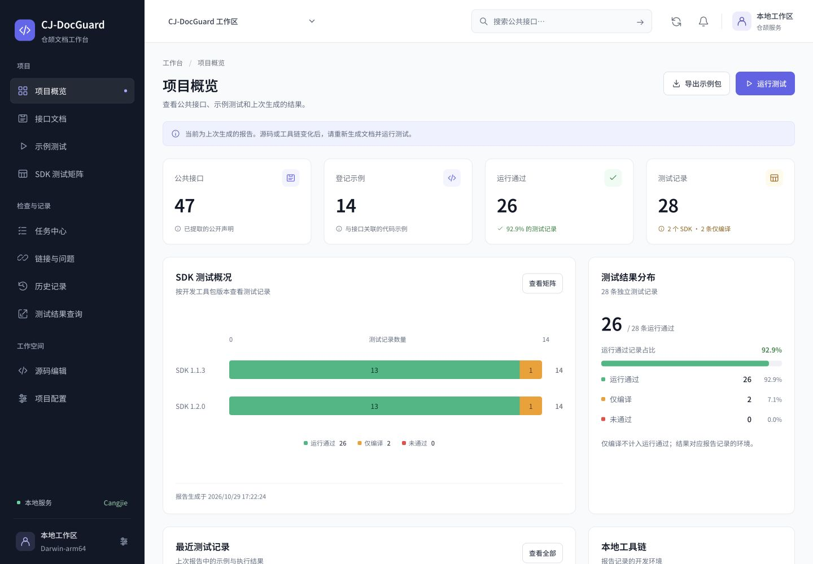
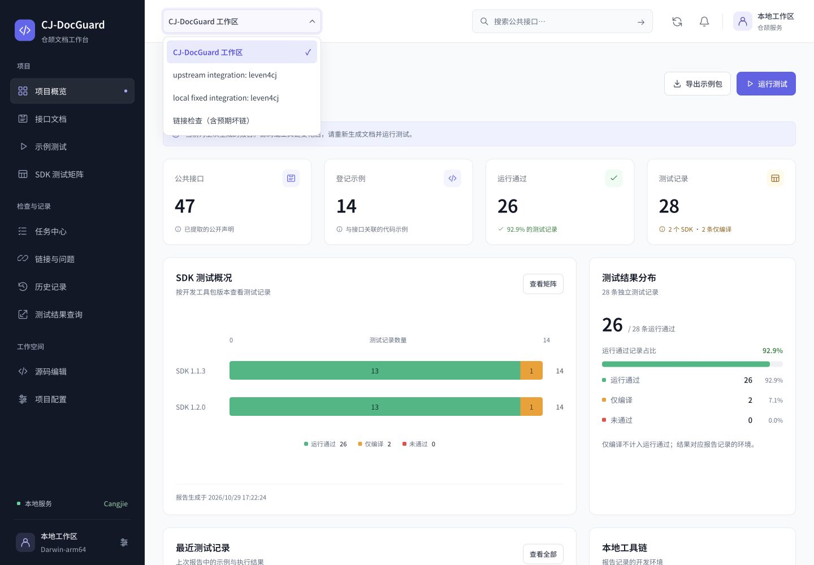
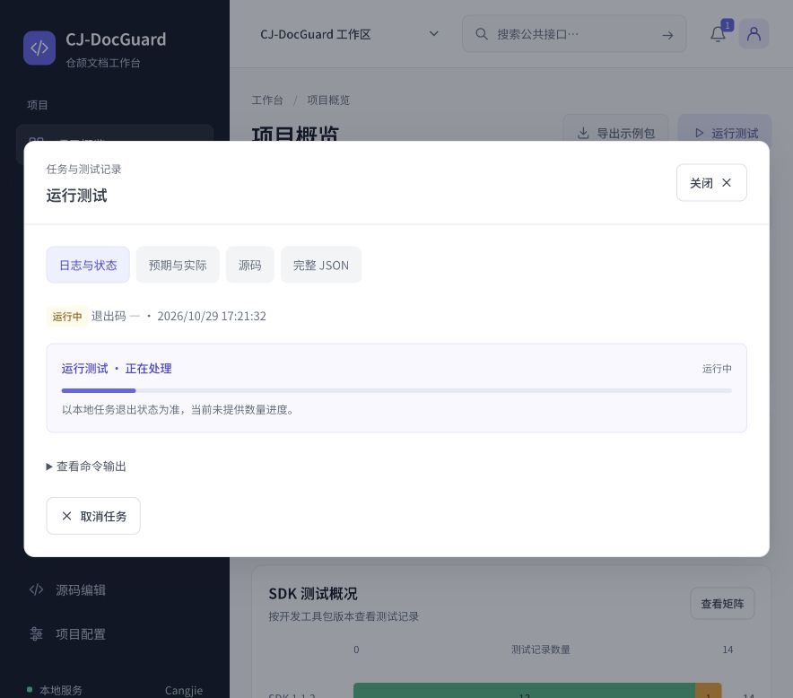

# 按钮、下拉选项与任务进度更新

本次基于 `ce255f97a837717a871f268e36fc251c184288fd` 继续完善；本目录所在提交为最终源码版本。运行环境为 macOS Darwin 25.6.0 / arm64，本地仓颉服务地址 `http://127.0.0.1:8765/`。

## 页面调整

- 按钮使用统一图标、主次样式、禁用和忙碌反馈；主要控件统一高度，手机端保持至少 44px 点击高度。
- 下拉选项统一背景、字体、间距、高亮和选中标记；支持方向键、Home/End、文字定位、Enter、Escape、Tab 和点击外部关闭。菜单按窗口空间定位，弹窗内也可完整显示。
- 查询中的 SDK、平台和示例改为实际配置/记录中的可选项；公共接口查询禁用无关环境条件，切换到有效示例或记录查询后启用。
- 导出表单使用实际示例、SDK 和平台选项，默认优先选择运行通过记录；缺少必要数据时禁用提交。最终有效性仍由本地工具校验。
- 任务中心选择的 SDK 在刷新结果、切换页面后保留，切换项目时重置。
- 工作区标签、项目显示名称和操作说明已清理用户指定用词；原始代码、日志、JSON 及协议标识保留原样。

## 比例与进度

- 通过率以 `运行通过 / 总记录数` 计算，26/28 显示 92.9%，填充长度对应实际比例。
- 仅编译、未通过和其他状态不填进运行通过部分，空数据不显示假百分比。
- 排队、运行和结束分别显示。服务端未提供数量进度时只显示运行状态条，不编造百分比；测试结束后展示返回的报告数量。
- 原始命令输出可展开查看，轮询更新时保留已展开的输出区域；失败状态会提示查看原因，内存不足有明确说明。

## 本地任务内存修复

实际点击运行测试时发现，长期工作区的报告生成超过仓颉命令进程默认堆上限，任务输出 `Out of memory`。相同工作区在显式 `cjHeapSize=1GB` 下完成测试，确认了资源配置原因。

工作台现为任务进程设置默认 1GB 最大堆上限，启动参数 `CJ_DOCGUARD_HEAP_SIZE` 可选择 256MB、512MB、1GB、2GB，无效值明确拒绝。未裁剪历史记录；最终报告包含 **739 条历史记录**，当前矩阵为 **26 条运行通过、2 条仅编译**。配置与官方参数来源见 [原生服务说明](../../native-workbench.md)。

## 检查结果

| 检查 | 结果 |
| --- | --- |
| 前端回归 | `node tests/test_workbench_ui.mjs` 通过，覆盖已有十页空/非空数据及本次控件、比例和字段联动 |
| 原生服务回归 | `python3 -m unittest discover -s tests -p test_native_workbench.py -v`：23 项通过，零失败、零跳过 |
| 实际网页测试任务 | 双 SDK 矩阵任务成功，退出码 0；26 条运行通过，2 条仅编译 |
| 查询 | 通过新的工具、环境与示例菜单提交，返回 arithmetic 的有效记录 |
| 导出 | SDK 1.2.0 / Darwin-arm64 / arithmetic 导出成功，提供 ZIP 下载 |
| 键盘选择 | End 后 Escape 保留 1.1.3；End 后 Enter 提交 1.2.0，原始表单值正确 |
| 页面与文案 | 1440×1000、1024×900、390×844 各十页，共 30 次检查，无整页横向溢出，默认页面无指定用词 |
| 手机菜单 | 项目菜单左右边界为 60～300px；导出 SDK 菜单为 34～356px，均在 390px 窗口内 |
| 控制台 | 本次最终检查无错误或警告 |
| 语法与格式 | JavaScript 语法检查、UTF-8 编码检查、`git diff --check` 通过 |

本次没有重跑项目全部 123 项历史集成测试。上述结果来自本轮前端回归、23 项原生 HTTP 回归和实际工作流；旧冻结标签及对应材料保持其历史版本含义。

输出：[前端回归](ui-tests.txt) · [原生服务回归](native-tests.txt) · [实际任务与历史数量](native-workflow.json) · [布局检查](layout-checks.json) · [原内存错误](heap-before.txt)。

## 实际页面

[手机通过率](rate-mobile.png) · [手机项目选项](options-mobile.png) · [手机导出选项](export-mobile.png) · [导出完成](export-completed.png)
