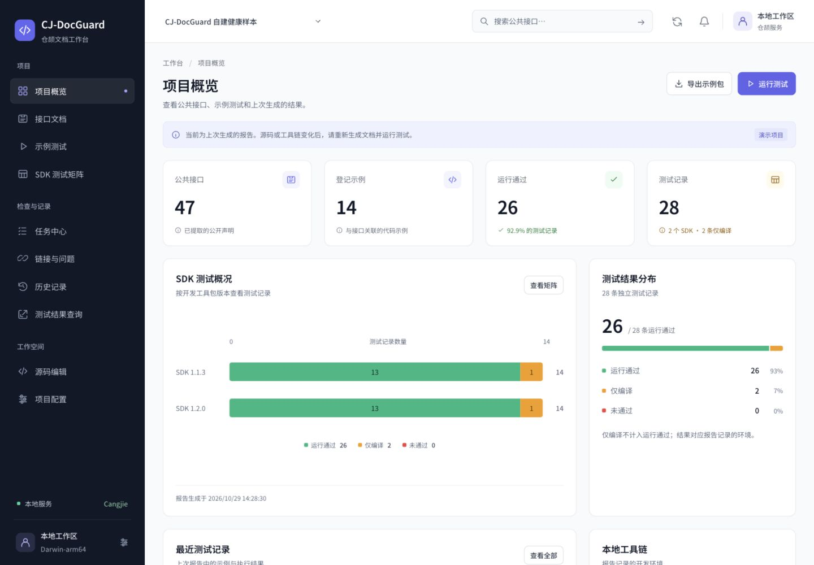
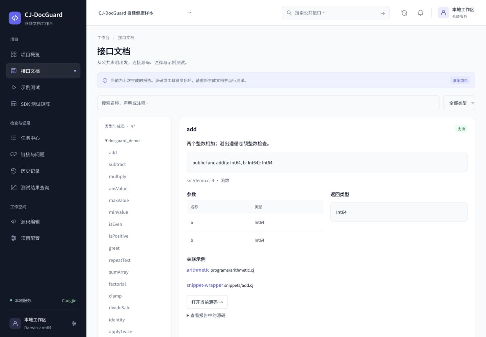
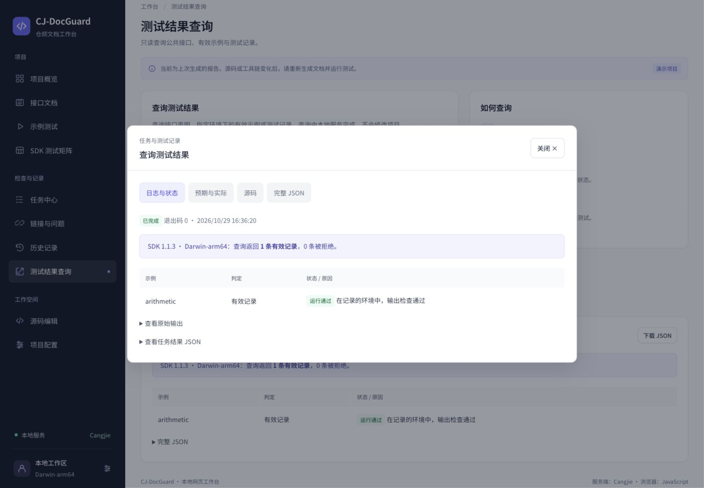

# Dashboard Layout 网页改版

本次根据用户提供的“仪表盘布局 / dashboard-layout”风格说明更新网页。基于 `3ab1a0037066986a9c7541ee905a13d9030e44cd` 继续修改；本目录所在提交标识最终版本。

## 实际页面

[平板截图](overview-tablet.png) · [手机截图](overview-mobile.png)

## 风格落实

| 用户指定规则 | 本次实现 |
| --- | --- |
| 深色固定侧栏 | 256px，#111827，统一线性图标与当前页面高亮；底部为本地工作区信息 |
| 白色顶部工具栏 | 项目切换、公共接口搜索、当前项目任务通知、本地工作区入口 |
| 主体层级 | 四列指标、约 2:1 主辅面板、最近测试表格、工具链与项目操作 |
| 字体与色彩 | 保留离线中文黑体；#f9fafb 背景、#111827 正文、#6366f1 靛蓝强调色 |
| 文字对比度 | 主按钮采用同色系 #6063eb，确保白字达到 4.5:1；主要正文、状态与图表数字共 9 组配色均通过计算 |
| 卡片、按钮、输入框 | 面板 12px、按钮与输入框 8px 圆角；统一边框、轻阴影、悬停、按下与焦点反馈 |
| 避免装饰与虚构数据 | 无营销插图、渐变文字、虚假账户或增长率；指标与图表从实际报告记录计算 |
| 响应式 | 大屏四列、平板两列、手机单列；手机隐藏侧栏，通过菜单展开 |
| 状态完整 | 保留加载、空、错误状态；运行通过、仅编译、未通过和其他状态分别显示 |

沿用项目的无构建前端，使用本地 CSS 实现对应样式，并保留指定的组件类名。运行工作台无需安装 Tailwind 或新增前端依赖。

当前报告未提供上一份完整报告用于比较，因此不显示增长百分比。图表中的百分比是本次报告内的测试记录占比，不代表项目覆盖率或普遍正确率。

## 新增交互

- 顶部搜索提交后进入接口文档并筛选声明，支持空白修剪；与每页表单草稿分开管理，避免切页恢复旧搜索词。
- 任务通知列出当前项目最近 8 条真实本地任务，点击打开对应任务详情；进行中的任务数由轮询更新。
- 手机导航展开后聚焦当前页面；Escape 关闭后返回菜单按钮，选择页面后自动收起。
- 通知弹窗提供对应的通知列表与完整 JSON 两个标签，可使用方向键和 Home/End 切换。
- 保留已有任务提交、源码与配置草稿、状态筛选、原始日志、JSON、历史记录和导出协议。

## 本次检查

环境：macOS Darwin 25.6.0 / arm64，仓颉本地网页服务 `http://127.0.0.1:8765/`。

| 检查 | 结果 |
| --- | --- |
| 前端回归 | `node tests/test_workbench_ui.mjs` 通过；新增精确统计、未知状态、空图表、搜索、通知、手机菜单和草稿隔离检查 |
| 失败基线 | 新增统计函数测试在实现前失败；输出保存在本地 `build/dashboard-red.log` |
| JavaScript 语法 | app.js、views.js、interaction.js 均通过 `node --check` |
| 布局 | 1440×1000、1024×900、390×844，各十页，共 30 次检查均无整页横向溢出 |
| 指标列数 | 实际测量分别为 4、2、1 列 |
| 面板结构 | 桌面十页均无卡片内嵌套卡片 |
| 搜索与源码 | 顶部搜索 divideSafe 得到一个声明及对应参数、返回类型、关联示例；源码入口可读取当前文件 |
| 状态与详情 | 仅编译筛选保留两版 SDK，详情明确未验证运行结果 |
| 任务通知 | 展示当前项目真实任务，点击可打开对应查询任务及其结果 |
| 新查询 | 2026-10-29 16:36:20，1.1.3 / Darwin-arm64 / arithmetic，返回 1 条有效记录、0 条拒绝 |
| 键盘 | 手机 Escape 返回菜单按钮；通知弹窗 ArrowRight 与 Home 切换正确 |
| 控制台 | 本次检查未捕获错误或警告 |
| 编码与格式 | 变更源码 UTF-8 无 BOM，`git diff --check` 通过 |

原始检查输出：[前端回归](ui-tests.txt)、[三档布局](browser-layout-checks.json)、[列数](responsive-columns.json)、[主要配色](contrast-checks.json)。

本次修改范围为网页及相关前端回归；没有重跑后端 123 项完整测试。此前 `finals-source-20261029-r2` 标签和材料保留其历史版本含义，未被覆盖。
