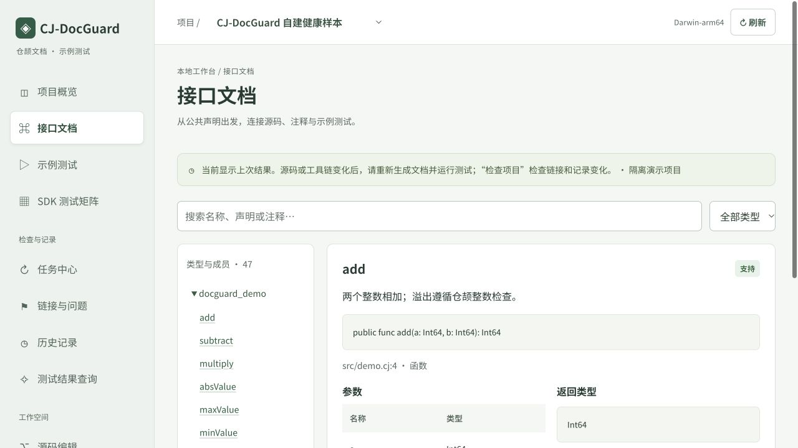
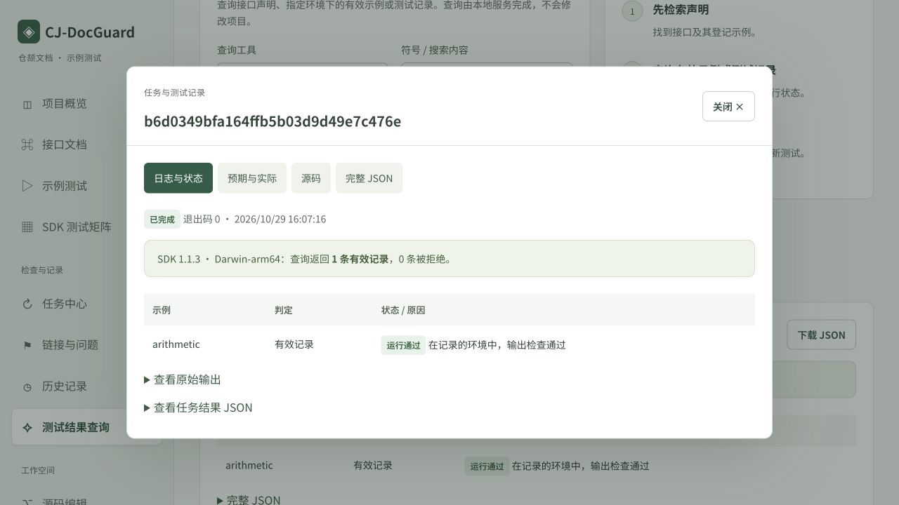
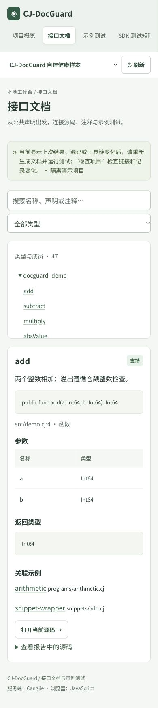

# 网页字体与功能文案更新（2026-10-29）

本次更新在 macOS Darwin 25.6.0 / arm64、运行中的仓颉本地服务 `http://127.0.0.1:8765/` 上检查。基于提交 `c33b1c3c740cc3375df3fa6849649c8f11823bce` 继续调整网页；最终变更由本文件所在提交标识。

## 页面调整

- 正文与标题使用本地分发的 DocGuard Sans SC 中文黑体；正文 16px，表格与按钮 14px，标题 32px。代码继续使用等宽字体。
- 导航直接对应十个实际页面：项目概览、接口文档、示例测试、SDK 测试矩阵、任务中心、链接与问题、历史记录、测试结果查询、源码编辑、项目配置。
- 操作直接标为检查环境、生成文档、运行测试、检查项目、导出示例包。
- 状态以中文显示，请求与筛选继续使用原有协议值。“仅编译”“需重测”“历史记录”与“运行通过”分开显示。
- 查询展示本地实际返回的记录表格，原始输出和完整 JSON 可展开查看。
- 页面将已保存报告称为“上次结果”，提醒源码或工具链变化后重新测试。

## 检查结果

| 检查 | 本次结果 |
| --- | --- |
| `node tests/test_workbench_ui.mjs` | 全部通过；含十页空/非空数据共 20 个渲染场景、事件与详情回归 |
| JavaScript 语法 / `git diff --check` | 通过 |
| 桌面浏览 | 十个页面均可进入，接口声明、参数、返回值和关联示例显示正确 |
| 搜索 | `divideSafe` 返回一个匹配声明及两个参数、`?Int64` 返回类型和关联示例 |
| 矩阵筛选与详情 | `COMPILE_ONLY` 显示两版 SDK 的仅编译记录；详情明确未验证运行结果 |
| 链接筛选与详情 | 健康项目共 178 条；筛选失败为 0，筛选通过后详情对应 README.md:5 → src/demo.cj |
| 本地查询 | SDK 1.1.3、Darwin-arm64、arithmetic 返回 1 条有效记录、0 条拒绝；任务详情显示实际结果表格 |
| 手机布局 | 390×844 下十页 `scrollWidth = clientWidth = 390`；表格和导航在自身容器内滚动 |
| 浏览器控制台 | 本次检查未捕获错误或警告 |
| 字体资源 | 2,079,696 字节，8,825 字形；当前界面中文字符均已覆盖；本地 HTTP 返回字节与提交文件一致 |

本次是前端更新与相关回归，未重新运行后端 123 项完整测试。既有 `finals-source-20261029-r2` 标签及该版本测试材料保留其历史版本含义；本次网页更新不重写该标签。

字体源版本、许可证与 SHA-256（文件内容校验值）见 [字体说明](../../../web/assets/fonts/README.md) 和 [来源记录](../../../web/assets/fonts/provenance.json)。网页使用已提交的字体文件，不需安装额外运行依赖。

## 实际页面

