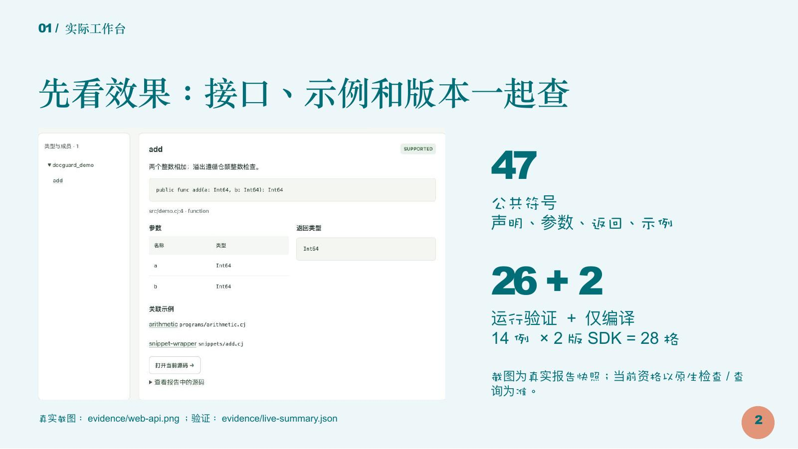

# CJ-DocGuard 决赛路演版

**推荐用主讲10页，标准7分20秒，已经包含90秒网页操作。** 另有4页备查，问答时按需打开，不追加进主讲逐页讲解。时间是排练目标，尚未声称完成真人计时。

| 用途 | 文件 |
|---|---|
| 现场放映 | [主讲10页PPTX](CJ-DocGuard-决赛路演-主讲10页.pptx) |
| 跨机器预览/应急 | [主讲PDF](CJ-DocGuard-决赛路演-主讲10页.pdf) |
| 含4页技术备查 | [14页PPTX](CJ-DocGuard-决赛路演-含备查14页.pptx) / [14页PDF](CJ-DocGuard-决赛路演-含备查14页.pdf) |
| 台词、时间与6/8分钟变体 | [演示讲稿](演示讲稿.md) |
| 浏览器操作与超时切换 | [90秒现场操作卡](现场操作卡.md) |
| 优先8题、完整25题 | [评委问答与证据入口](评委问答.md) |
| 生成源码与逐页检查 | [slides/](slides/) / [QA.md](QA.md) |

主线：实际工作台效果 → 原版/修复对照与链接检查 → 证据准入与仓颉架构 → 初赛后改进 → 最终验证 → 公开克隆复现。

本版加入R2真实网页截图，明确26运行+2仅编译、原版36/40+4失败与修复40/40、123项集成/20个原生程序、655条历史120次读取各自的口径；不把测试数当覆盖率、把读取成功当性能提升，或把本机复现当全新系统安装。Python过渡工作台是初赛后演进中的状态，不冒称初赛基线已有该服务。

## 再生成

生成需要Node.js和PptxGenJS 4.0.1，已固定在本目录package.json。修改台词可编辑`content.json`；重排各页秒数时保持标准440秒（网页90秒）、压缩360秒、扩展480秒及起止时间一致。在本目录执行：

```bash
npm install
npm run build
```

它同步生成两套PPT与`演示讲稿.md`；逐页备注使用相同内容。具体布局位于`slides/slide-01.js`至`slide-14.js`，静态排练建议位于`script-guidance.md`。截图从上级`evidence/`引用，原PNG不改，PPT内已嵌入图像，可单独打开。

PDF可用已安装的LibreOffice导出。本次实际使用macOS宿主LibreOffice 26.2.4和Poppler渲染核验；目标机器若替换中文字体，建议优先用配套PDF核对排版。

功能源码仍为`finals-source-20261029-r2` / `075aeb38fc32d46680f312e8ac3647a0977e1366`。本次只更新演示材料，不改引擎、不改测试断言、不移动冻结标签。验收证据与源身份见[上一层验证记录](../VERIFICATION.md)和[公开克隆回执](../PUBLIC-CLONE.md)。

## 内容与证据分布

| 评阅关注点 | 对应主讲/备查 |
|---|---|
| 实际效果 | 2–3页：真实接口与原版/修复断言 |
| 技术方案 | 4–5、7页：准入、仓颉链路、链接与身份 |
| 初赛后改进 | 6页：入口、正确性、交付三组对照 |
| 验证与复现 | 8–9页：各自口径的测试与公开克隆 |
| 掌握程度与追问 | 11–14页及25题问答；未知边界直接说明 |


